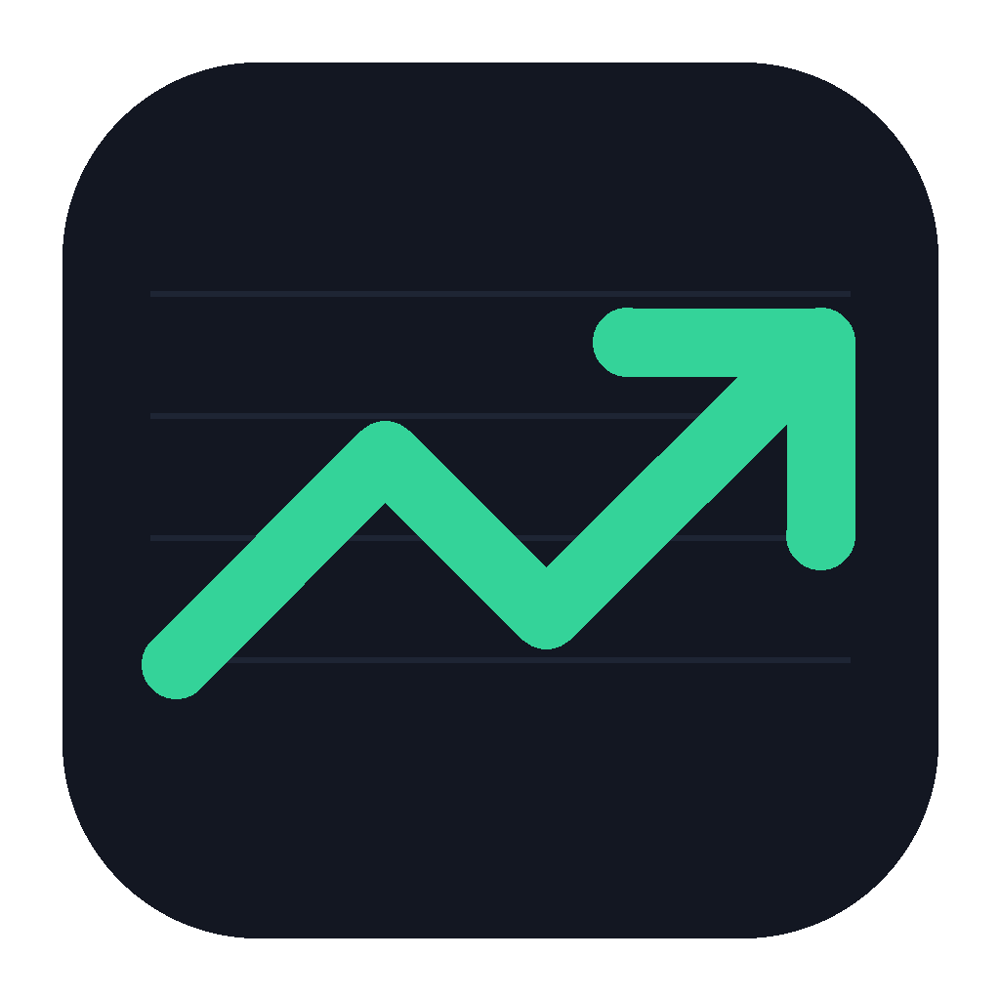

# Stek

Open-source charting and technical analysis for your desktop. Candlestick charts for stocks, ETFs, mutual funds, indexes, crypto, FX and futures, with drawing tools, indicators, bar replay and live prices.



## Download

**[Download Stek](https://imperiumthenum-coder.github.io/stek/)**, or grab an installer from the **[Releases page](https://github.com/imperiumthenum-coder/stek/releases/latest)**:

| Platform | File |
|---|---|
| **macOS** (Apple Silicon: M1 and newer) | `Stek-<version>-mac-arm64.dmg` |
| **Windows** (64-bit) | `Stek-<version>-win-x64.exe` |
| **Linux** (64-bit) | `Stek-<version>-linux-x86_64.AppImage` or `Stek-<version>-linux-amd64.deb` |

Intel Macs aren't supported.

### First launch

Stek isn't code-signed yet, so your OS will ask you to confirm once:

- **macOS:** open the `.dmg` and drag Stek to Applications. The first time, macOS says it can't verify the developer. Go to **System Settings → Privacy & Security**, scroll down and click **Open Anyway**. If macOS instead says the app "is damaged", run this once in Terminal:
  ```bash
  xattr -dr com.apple.quarantine /Applications/Stek.app
  ```
- **Windows:** if SmartScreen says "Windows protected your PC", click **More info → Run anyway**.
- **Linux (.deb):** `sudo apt install ./Stek-<version>-linux-amd64.deb`, then launch Stek from your app menu.
- **Linux (AppImage):** `chmod +x Stek-*.AppImage`, then run it. On Ubuntu 22.04 and newer, AppImages need FUSE: `sudo apt install libfuse2` (on 24.04: `libfuse2t64`).

## Features

- **Charts:** 1m, 5m, 15m, 30m, 1h, daily, weekly and monthly candles, with search across stocks, ETFs, mutual funds, indexes, crypto, FX and futures.
- **Drawing tools:** trendlines, rays, horizontal and vertical lines, parallel and price channels, Fibonacci retracement, rectangles, circles, half circles, triangles, parallelograms, freehand brush and notes. Drawings save automatically per symbol and stay put across timeframes.
- **Indicators:** MA, EMA, Bollinger Bands, SAR, volume, MACD, RSI, KDJ, OBV, CCI and Williams %R.
- **Bar replay:** step through history from any start date.
- **Watchlist:** watchlist symbols are kept synced in the background, so they open instantly.
- **Local storage:** price history is cached on your machine and keeps growing past what the data source keeps (for example, 1-minute bars beyond 30 days).
- **Phone-friendly layout** when served to a phone's browser (see [Self-hosting](#self-hosting)).

## Data sources

- **Yahoo Finance (default).** History, search and live prices polled every few seconds. Yahoo's data is free but unofficial and may be delayed depending on the exchange (many non-US exchanges are about 15–20 minutes behind).
- **Interactive Brokers (optional, real time).** If you have an IBKR account, run [IB Gateway](https://www.interactivebrokers.com/en/trading/ibgateway-stable.php) and log in. In **Configure → Settings → API → Settings**, turn on *Enable ActiveX and Socket Clients*, keep **Read-Only API** checked, and leave the port at 4001. Stek connects automatically and the status bar shows **LIVE · IBKR**. Exchanges you don't have a market data subscription for come through delayed (**DELAYED · IBKR**). Stek streams US stocks and ETFs, major crypto (BTC, ETH, LTC, BCH) and FX pairs from IBKR; everything else stays on Yahoo.

Override the IBKR connection with environment variables `IB_HOST`, `IB_PORT` (4002 for a paper account, 7496 for TWS) and `IB_CLIENT_ID`.

## Where your data lives

Everything is stored in one SQLite file, `stek.db`, in your app data folder:

- macOS: `~/Library/Application Support/Stek/`
- Windows: `%APPDATA%\Stek\`
- Linux: `~/.config/Stek/`

Every night at 3 AM, Stek also exports all stored price history as compressed CSV files to an `archive` folder next to the database. Set `ARCHIVE_DIR` to put them elsewhere, such as a NAS mount.

## Self-hosting

Run Stek as a web app, for example on a home server you reach from your phone:

```bash
# backend: API on port 4000, data in ./data
cd backend && npm install && npm run dev

# frontend: in another terminal, served on port 3000 (proxies /api to the backend)
cd frontend && npm install && npm run dev
```

Open `http://<server>:3000`. There's no login, so keep it on your own network or a private VPN like Tailscale. Don't expose it to the internet.

Environment variables for the backend: `PORT`, `HOST`, `STEK_DATA_DIR`, `ARCHIVE_DIR`, `ARCHIVE_HOUR`, `IB_HOST`, `IB_PORT`, `IB_CLIENT_ID`.

## Development

The repo has three packages:

- `frontend/`: React + Vite UI, charts by [KLineChart](https://github.com/klinecharts/KLineChart)
- `backend/`: Express API, SQLite storage, Yahoo and IBKR data feeds
- `desktop/`: Electron shell that runs the backend inside the app

Build the desktop app for your current platform:

```bash
cd frontend && npm ci && cd ../backend && npm ci && cd ../desktop && npm ci
npm run dist          # installers land in desktop/release/
npm start             # or just run it unpackaged
```

### Releasing

Bump `version` in `desktop/package.json`, commit, then tag and push:

```bash
git tag v0.1.0 && git push origin v0.1.0
```

GitHub Actions builds the macOS (Apple Silicon), Windows and Linux installers and publishes them as a release.

## Disclaimer

Stek is for charting and research. It is not investment advice, and market data may be delayed, incomplete or wrong. Stek is not affiliated with TradingView, Yahoo or Interactive Brokers.

## License

[MIT](LICENSE). Charts are rendered with [KLineChart](https://github.com/klinecharts/KLineChart) (Apache-2.0).
